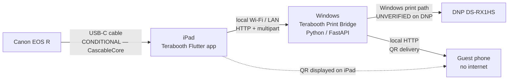
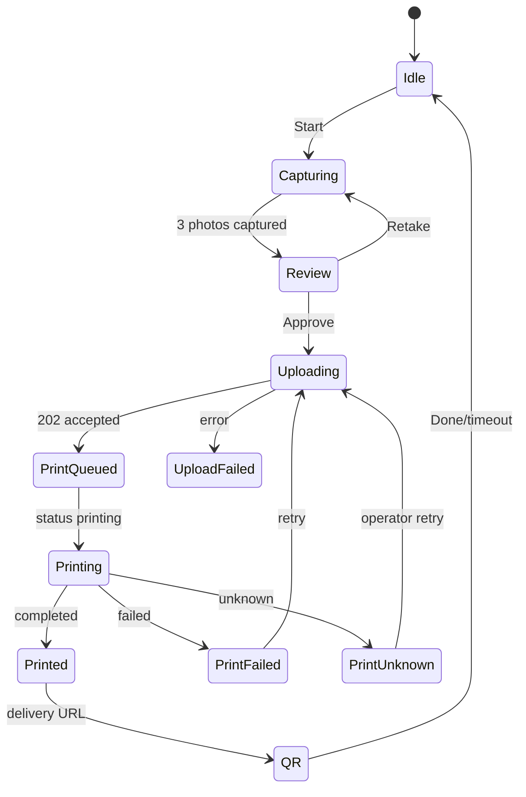
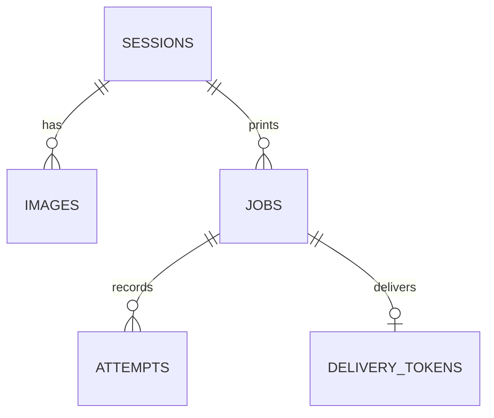
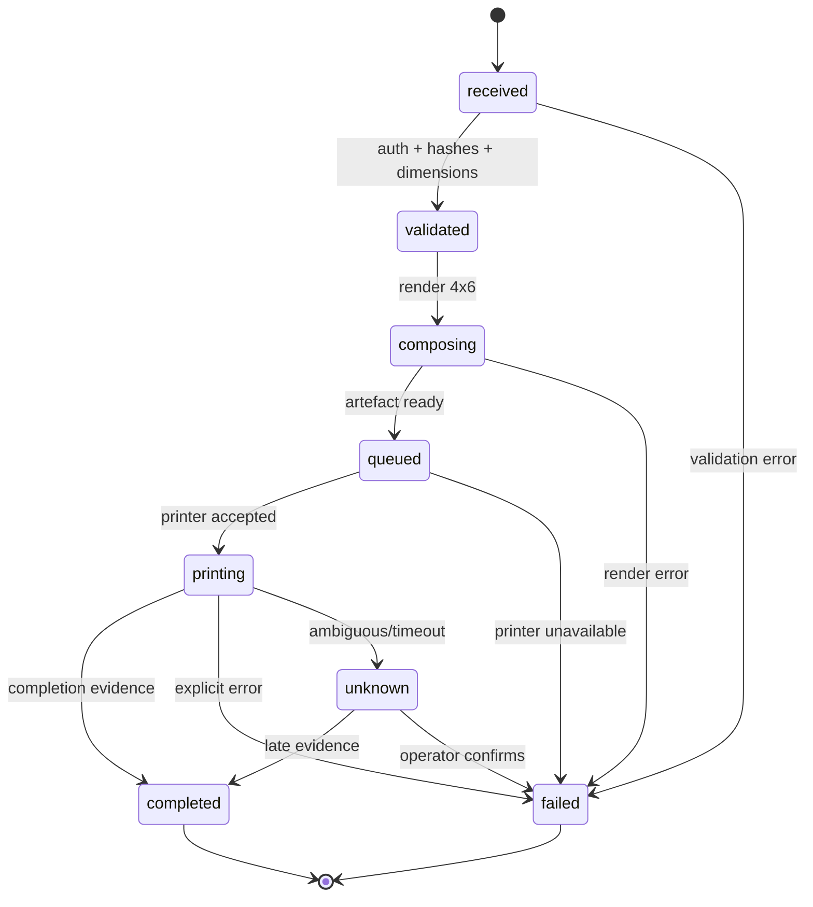

# Terabooth Event MVP — Architecture

> **Status:** Phase 0 architecture, written before implementation. Camera gate is conditional (see `CANON_EOS_R_IPAD_FEASIBILITY.md`).
> **Scope:** one paid event, Saturday 14 November 2026. Not a SaaS product.
> **Rule:** implemented, simulated, verified and unverified functionality are labelled separately. No feature is “working” because it compiles.

---

## 1. Topology



| Node | Responsibility |
|---|---|
| **Canon EOS R** | Image capture; controlled **only** by the iPad |
| **iPad Flutter app** | Guest/operator UI, camera control, capture, local originals, preview/retake/approve, print request, status, QR display |
| **Windows Print Bridge** | Receive images/metadata, validate, persist, compose 2×6, print, track jobs, host QR delivery |
| **DNP DS-RX1HS** | Physical 2×6 output from 4×6 media |
| **Guest phones** | Scan QR, download original/strip over LAN |

**No Windows camera code.** No Canon SDK, EOS Utility, folder watching or tethering on Windows.

---

## 2. iPad application

### 2.1 Screens

| Screen | Purpose | Required behaviour |
|---|---|---|
| **Welcome** | Attract/start | Event branding; camera status; Start Session; operator setup |
| **Capture** | Countdown + capture | 3-photo countdown; live preview if available; capture; progress |
| **Review** | Preview/retake/approve | Show 3 originals; retake individual/all; approve |
| **Print** | Submit + status | Upload to bridge; show honest job state; retry/reprint |
| **QR** | Guest delivery | Display QR after bridge validation; instructions |
| **Setup** (operator) | Bridge URL/token, event name, camera mode | Minimal; not guest-facing |

### 2.2 State machine



The app must not show “Printed” on `202 Accepted`; it waits for `completed` (or shows “Sent — check booth” for `assumed`).

### 2.3 Camera abstraction

```dart
abstract class CameraService {
  Future<void> connect();
  Future<void> disconnect();
  Stream<CameraStatus> get status;
  Future<CapturedImage> capture();
}
```

| Implementation | Status | Notes |
|---|---|---|
| `MockCameraService` | **Implemented/verified in tests** | Generates deterministic test images; UI development only |
| `CascableCameraService` | **Not implemented** | Requires CascableCore licence, Swift plugin, Xcode and EOS R hardware; must not fake success |
| `DeviceCameraService` | Optional fallback | iPad built-in camera via `camera` plugin; not Canon |
| `UnavailableCameraService` | Implemented | Reports a clear error; used when no verified camera path exists |

**Critical:** no simulated image may be presented as a real EOS R capture. The UI must display “SIMULATED CAMERA” when using `MockCameraService`.

### 2.4 Local storage

- Root: app documents directory.
- Path: `events/<event_id>/sessions/<session_id>/original_<n>.jpg`.
- Atomic write: temp file → fsync → rename.
- Session metadata JSON alongside images: event, session, capture timestamps, camera mode, hashes.
- Originals retained after upload; never deleted by the print flow.
- Startup reconciliation: scan disk + metadata; no orphan loss.

### 2.5 Simple state management

- `ChangeNotifier` + `ValueNotifier` only. No Provider/Riverpod/Bloc dependency.
- One `BoothController` owns session state, camera service, storage, bridge client.
- UI listens via `AnimatedBuilder`/`ValueListenableBuilder`.

---

## 3. Windows Print Bridge

### 3.1 Stack

| Layer | Choice |
|---|---|
| Language | Python 3.11+ |
| API | FastAPI + Uvicorn |
| Image processing | Pillow |
| Persistence | SQLite (stdlib `sqlite3`) |
| QR | `qrcode` + Pillow |
| Printing | Windows spooler adapter; mock adapter for macOS |
| Delivery | FastAPI static/HTML routes |

No database server, no cloud, no auth provider.

### 3.2 Responsibilities

- Receive multipart images + JSON metadata.
- Validate auth, hashes, dimensions, count, total size.
- Persist session/images/job atomically.
- Compose 2×6 strip on 4×6 canvas.
- Submit to printer adapter.
- Track job state and completion confidence.
- Serve guest delivery page/token.
- Retain images for configurable period; cleanup command.

### 3.3 API

| Method | Path | Purpose |
|---|---|---|
| `GET` | `/v1/health` | Bridge/printer status |
| `POST` | `/v1/print-jobs` | Create job (multipart) |
| `GET` | `/v1/print-jobs/{id}` | Job status |
| `GET` | `/v1/print-jobs/{id}/artefact` | Composed image |
| `POST` | `/v1/print-jobs/{id}/reprint` | New reprint job |
| `DELETE` | `/v1/print-jobs/{id}` | Cancel if not printing |
| `GET` | `/v1/printers` | Printer list/status |
| `GET` | `/d/{token}` | Guest page |
| `GET` | `/d/{token}/original/{image_id}` | Guest original |
| `GET` | `/d/{token}/strip` | Guest strip |
| `GET` | `/d/{token}/qr.png` | QR image |

Auth: `Authorization: Bearer <token>`; configurable via environment. If unset, log a warning and allow local-only (event setup must set it).

Idempotency: required `Idempotency-Key`; unique DB index; duplicate returns the existing job with `duplicate: true`.

### 3.4 Data model



- `sessions(id, event_id, created_at)`
- `images(id, session_id, job_id, filename, sha256, width, height, path, created_at)`
- `jobs(id, session_id, event_id, idempotency_key, state, completion, attempts, printer, template, error, delivery_token, created_at, updated_at, completed_at, reprint_of)`
- `attempts(id, job_id, state, detail, created_at)`
- `delivery_tokens(token_hash, job_id, expires_at, created_at)`

### 3.5 Print job lifecycle



- `completed` is **not** set on HTTP 202 or spooler acceptance.
- `unknown` is terminal until operator action; **never auto-resubmitted**.
- `reprint` always creates a new job with `reprint_of`.
- Startup: `printing`/`unknown` jobs are reconciled; unresolved remain `unknown`.

### 3.6 Printer adapters

| Adapter | Platform | Status |
|---|---|---|
| `MockPrinter` | macOS/Windows | **Implemented/tested** — writes artefact, simulates success/failure/unknown |
| `WindowsSpoolerPrinter` | Windows | **Code path, unverified** — uses PowerShell `System.Drawing.Printing`; requires actual DNP test |
| `HotFolderPrinter` | Windows | Optional fallback — writes to DNP HFP folder; archive move as evidence; **unverified** |
| `NullPrinter` | any | For API tests without file output |

**Do not claim DNP compatibility from a macOS mock.** The Windows/DNP path must be verified physically.

### 3.7 2×6 composition

- Canvas: 4×6 in at 300 dpi = **1200×1800 px**.
- Strip: 2×6 in at 300 dpi = **600×1800 px**.
- Two identical strip panels side by side (left/right).
- 3 photos per strip, `cover` crop, fixed margins, event title/date.
- Output: JPEG quality 95, 300 dpi metadata.
- No distortion; no unexpected borders; validate dimensions in tests.

### 3.8 QR delivery

- Token: HMAC-SHA256 over `{event_id, session_id, job_id, exp}`; URL-safe.
- `delivery_url = http://<bridge-lan-ip>:8787/d/<token>`.
- Never use `localhost`/`127.0.0.1` in guest QR.
- Token TTL 24 h (configurable); event-scoped.
- Guest page: no login; original + strip download; mobile-friendly.
- Delivery available as soon as images are validated, even if printing later fails.
- Firewall: inbound port 8787 on Private profile; document setup.
- Router/hotspot must allow client-to-client traffic; no AP isolation.

---

## 4. Failure handling

| Failure | Behaviour |
|---|---|
| Camera disconnected | iPad shows error; session paused; originals already saved remain |
| Upload fails | Retry button; no print job created; originals retained |
| Bridge unreachable | Health check fails; clear operator message; no silent queue |
| Duplicate submit | Same idempotency key returns original job; no second print |
| Printer offline | Job `failed`; iPad shows failure; QR still available if validated |
| Ambiguous print | Job `unknown`; iPad says “check booth”; no auto-resubmit |
| App restart | SQLite + originals survive; job reconciliation; no duplicate |
| Network loss | iPad/bridge reconnect; pending status poll resumes; no lost originals |
| Disk full | Preflight check; reject new session with clear error |

---

## 5. Security and privacy

- LAN-only; no internet dependency.
- Bearer token on all bridge API calls.
- HMAC delivery tokens; short TTL; event/session scoping.
- No path traversal: image IDs resolve through DB, not user paths.
- Guest page serves only that job’s artefacts.
- No PII collection; no accounts.
- Logs redact tokens and guest data.
- Images retained only for the configured window; cleanup command.

---

## 6. Testing strategy

| Layer | Tool | What it proves |
|---|---|---|
| Python unit | pytest | validation, idempotency, state transitions, composition dimensions, token expiry |
| Python API | FastAPI TestClient/httpx | health, submit, duplicate, status, QR, reprint |
| Printer mock | pytest | state machine and no duplicate on retry |
| Flutter unit | `flutter test` | camera mock, storage naming, idempotency key, status parsing |
| Flutter widget | `flutter test` | welcome/capture/review/QR render with fakes |
| Manual | macOS browser/curl | QR page/download through LAN |
| Hardware | iPad + EOS R + Windows + DNP | **unverified until performed** |

**Not tested in this environment:** iOS build (no Xcode), camera capture (no iPad/EOS R), Windows print (no Windows/DNP), physical 2×6 cut, guest phone downloads (no phone). These remain unverified.

---

## 7. Deployment

### iPad
- Flutter iOS build via Xcode; install via Xcode/TestFlight.
- `Info.plist`: Local Network usage, ATS local networking; camera permissions if device camera fallback.
- Kiosk: Guided Access; disable auto-lock; charger connected.

### Windows
- Python 3.11 venv; `pip install -r requirements.txt`.
- Run `uvicorn app.main:app --host 0.0.0.0 --port 8787`.
- Firewall inbound rule; static IP/DHCP reservation.
- Printer driver installed; default printer configured; test print.
- Optional Windows service via NSSM/Task Scheduler (defer).

---

## 8. Non-goals

- Login/accounts/cloud/subscriptions/payments/analytics.
- Complex event management.
- AI, filters, video, GIF, 360.
- Multi-printer, multi-booth.
- Commercial architecture or microservices.
- Windows camera control.

---

## 9. Risks

| Risk | Impact | Mitigation |
|---|---|---|
| Canon cable path blocked | No EOS R capture | CascableCore spike by Tue noon; fallback iPad camera/proven rig |
| Xcode/CocoaPods missing | No iOS build | Install full Xcode + CocoaPods immediately; otherwise no app |
| No iPad/EOS R | G0 unverified | Physical hardware required |
| Windows/DNP unavailable | No physical prints | Test on actual Windows/DNP; otherwise event fallback |
| QR network isolation | Guests cannot download | Travel router; no AP isolation; test phones |
| 5-day scope | Incomplete | Freeze features; prioritize capture → storage → transfer → print → QR |
| Duplicate prints | Guest/operator confusion | Idempotency + no auto-resubmit unknown |
| 2×6 crop/cut wrong | Wrong product | Test prints with ruler; fixed template; verify dimensions |

---

## 10. Sources

- Canon CAP: <https://asia.canon/en/campaign/developerresources/cap>
- Cascable EOS R compatibility: <https://compatibility.cascable.se/canon/eos-r/>
- CascableCore: <https://developer.cascable.se/>
- DNP DS-RX1HS: <https://www.dnpphoto.com/products/printers/rx1hs>
- Microsoft PrintJobStatus: <https://learn.microsoft.com/en-us/windows-hardware/drivers/ddi/printerextension/ne-printerextension-tagprintjobstatus>
- FastAPI: <https://fastapi.tiangolo.com/>
- Pillow: <https://pillow.readthedocs.io/>
